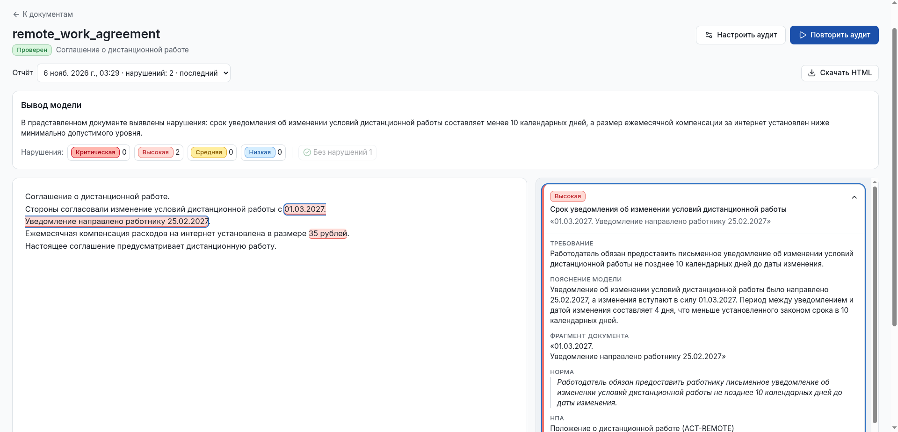
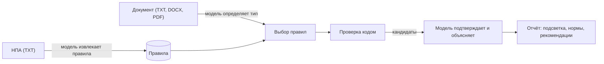
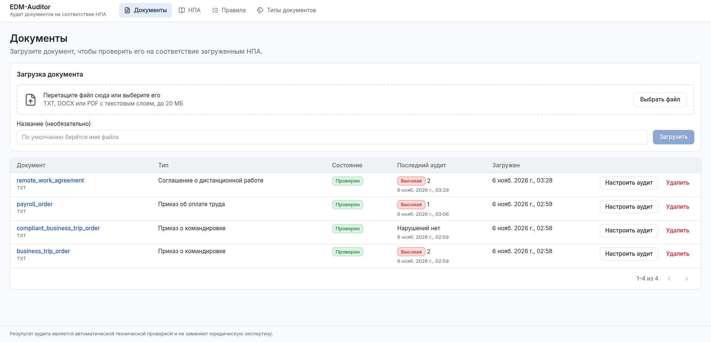
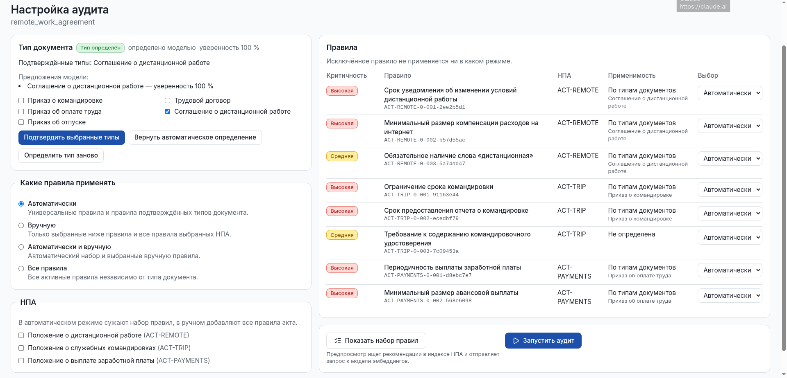
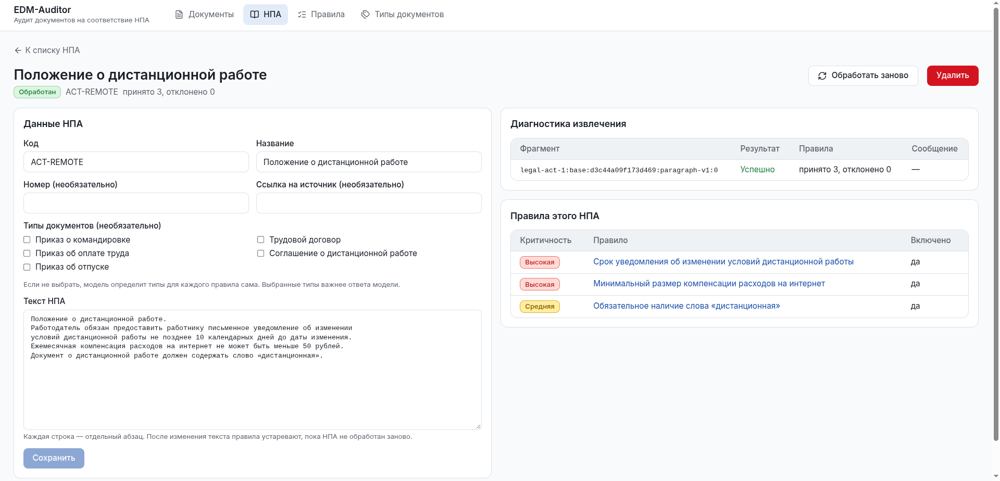
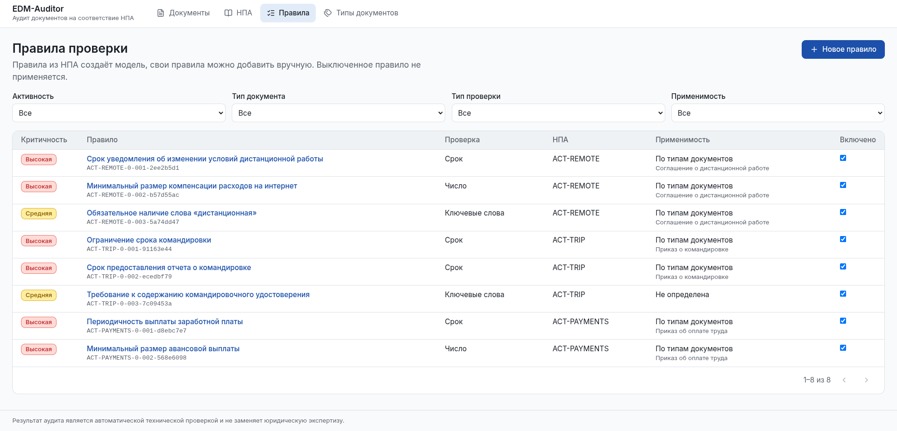
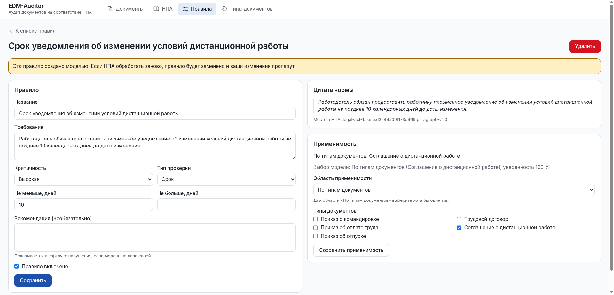
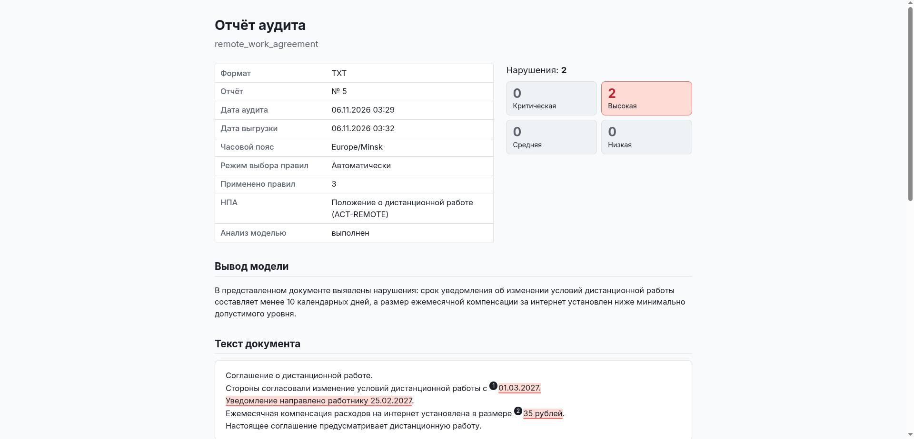
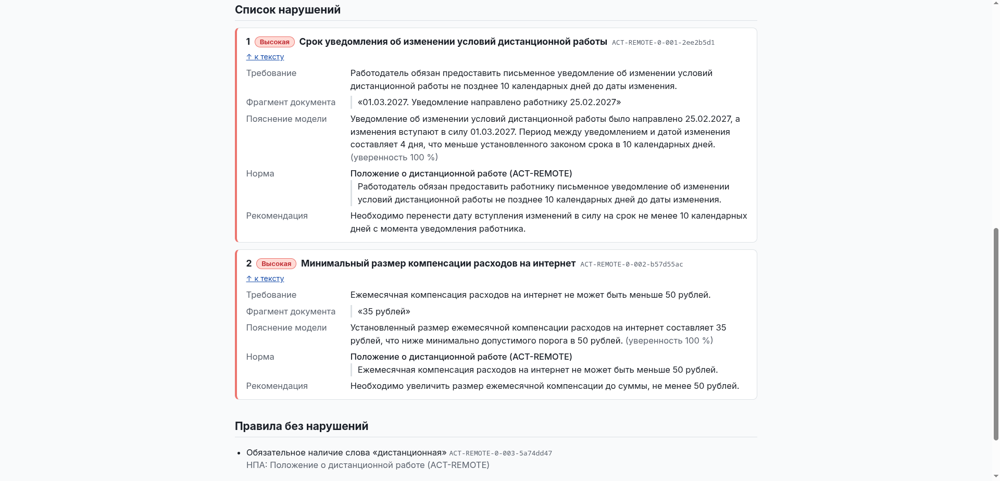

# EDM-Auditor

Система автоматизированного аудита электронных документов на соответствие нормативно-правовым актам Республики
Беларусь. Курсовой проект БГУИР.

Пользователь загружает НПА, языковая модель извлекает из него проверяемые правила, а система проверяет по ним
документы: трудовые договоры, приказы, соглашения. Нарушения подсвечиваются в тексте документа, у каждого есть
норма, пояснение модели и рекомендация по исправлению.



*Экран аудита: слева текст документа с подсветкой нарушений, справа карточка выбранного нарушения с нормой,
пояснением модели и рекомендацией.*

> Результат аудита — автоматическая техническая проверка. Она не заменяет проверку юристом.

## Возможности

- **Загрузка документов** TXT, DOCX и PDF с текстовым слоем перетаскиванием файла. Модель определяет тип
  документа, неуверенный ответ подтверждает человек.
- **База НПА.** Из загруженного акта модель извлекает правила с точной цитатой нормы, типом проверки,
  критичностью и типами документов, к которым правило относится. Акт и его правила можно изменять.
- **Аудит.** Правила проверяются кодом: ключевые слова, регулярные выражения, числа, суммы, проценты, даты и
  сроки. Модель подтверждает спорные нарушения и объясняет каждое. Набор правил выбирается автоматически по
  типу документа или вручную, перед запуском его можно посмотреть.
- **Экран аудита.** Слева текст документа с цветной подсветкой нарушений, справа их список с фильтром по
  критичности. Клик по фрагменту открывает карточку, клик по карточке прокручивает текст. Можно посмотреть и
  правила, которые документ выполнил.
- **Отчёт в HTML.** Один файл со сводкой, текстом документа и карточками нарушений. Открывается без сети,
  печатается и сохраняется браузером в PDF.
- **Справочники.** Правила включаются и выключаются, создаются вручную; каталог типов документов пополняется по
  предложениям модели.

## Как это работает



Модели задаются пресетом. Основной пресет использует Google Gemini (`gemini-3.1-flash-lite` и эмбеддинги
`gemini-embedding-2`), подходит бесплатный ключ Google AI Studio. Есть пресеты для LM Studio и OpenRouter, см.
[`docs/model-configuration.md`](docs/model-configuration.md).

## Экраны



*Документы: загрузка перетаскиванием и список с итогом последнего аудита по критичности.*



*Настройка аудита: подтверждение типа документа, режим выбора правил и предпросмотр набора правил.*



*Страница НПА: текст акта и правила, которые модель из него извлекла.*



*Правила: фильтры, критичность и включение правил.*



*Правило: параметры проверки, цитата нормы и применимость к типам документов.*



*Отчёт в HTML: сводка по аудиту и текст документа с пронумерованной подсветкой.*



*Отчёт в HTML: карточки нарушений и правила без нарушений.*

## Запуск

Нужны Docker с Docker Compose v2 и ключ Google AI Studio.

```bash
cp backend/.env.example backend/.env
# В backend/.env укажите EDM_MODEL_PRESET=google-ai-studio и GEMINI_API_KEY
docker compose up --build -d
```

Интерфейс откроется на <http://localhost:8080>, документация API на <http://localhost:8080/docs>. Данные
хранятся в томе Docker и сохраняются между перезапусками. Остановка: `docker compose down`. Подробности,
перенос базы и ограничения описаны в [`docs/docker.md`](docs/docker.md).

### Без Docker

Для разработки бэкенд и интерфейс запускаются отдельно: Python 3.11+ и Node.js 22.22+.

```bash
cd backend
python3 -m venv .venv && source .venv/bin/activate
python -m pip install -e ".[test]"
cp .env.example .env    # пресет и ключ
alembic upgrade head
uvicorn edm_auditor.api.app:create_app --factory --reload
```

```bash
cd frontend
npm install
npm run dev             # http://localhost:5173
```

### Первый аудит

В [`backend/examples/`](backend/examples/) лежат синтетические НПА и документы: с нарушениями и без них.

1. На странице **НПА** загрузите `legal_act_remote_work.txt` и проверьте извлечённые правила.
2. На странице **Документы** загрузите `remote_work_agreement.txt`.
3. Запустите аудит: система найдёт нарушения срока уведомления и размера компенсации.
4. Скачайте отчёт кнопкой **Скачать HTML**.

На бесплатном тарифе Gemini лимит 15 запросов в минуту: делайте паузы между загрузками и аудитами.

## Тесты

Тестам не нужны сеть, ключи и модели.

```bash
cd backend && pytest -q
cd frontend && npm test
```

## Структура

| Путь                                       | Содержимое                                                       |
|--------------------------------------------|------------------------------------------------------------------|
| [`backend/`](backend/README.md)            | API на FastAPI, разбор документов, извлечение правил, аудит, RAG |
| [`frontend/`](frontend/README.md)          | Интерфейс на React, TypeScript, Vite и Tailwind CSS              |
| [`docker-compose.yml`](docker-compose.yml) | Запуск системы одной командой                                    |
| [`docs/`](docs/)                           | Требования, состояние, отладка, настройка моделей                |

## Документация

| Файл                                                         | Что внутри                                               |
|--------------------------------------------------------------|----------------------------------------------------------|
| [`docs/TASK.md`](docs/TASK.md)                               | Техническое задание и состояние каждого требования       |
| [`docs/DEVLOG.md`](docs/DEVLOG.md)                           | Текущее состояние, известные проблемы и журнал изменений |
| [`docs/TODO.md`](docs/TODO.md)                               | Оставшиеся и отложенные задачи                           |
| [`docs/DIPLOMA.md`](docs/DIPLOMA.md)                         | Что перенесено в дипломный проект                        |
| [`docs/docker.md`](docs/docker.md)                           | Запуск через Docker Compose                              |
| [`docs/DEBUG.md`](docs/DEBUG.md)                             | Работа с API через `curl` и отладка                      |
| [`docs/model-configuration.md`](docs/model-configuration.md) | Модели, пресеты и лимиты                                 |
| [`backend/README.md`](backend/README.md)                     | API: эндпоинты, ошибки, устройство бэкенда               |
| [`frontend/README.md`](frontend/README.md)                   | Устройство интерфейса и правила для кода                 |

## Ограничения

- Работает с небольшими НПА: большой акт вроде Трудового кодекса быстро исчерпывает лимит модели, а один
  неудачный фрагмент останавливает публикацию всех правил акта.
- Требования без сравниваемого значения пока не проверяются, например частота выплат «не реже двух раз в
  месяц». Список таких задач ведётся в [`docs/TODO.md`](docs/TODO.md).
- Входа и ролей нет: запускайте систему только на своём компьютере или в доверенной сети.
- Семантический аудит, извлечение фактов, роли, конструктор документов, ЭЦП и выгрузка в PDF и DOCX
  перенесены в дипломный проект, см. [`docs/DIPLOMA.md`](docs/DIPLOMA.md).
