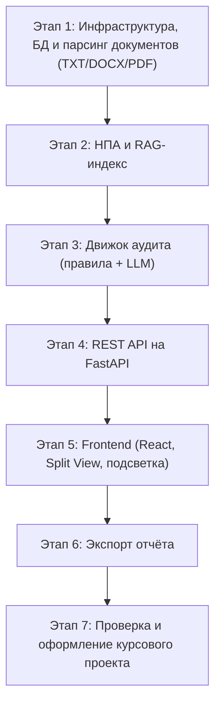

# Техническое задание (TASK.md)

## Курсовой проект: «Система автоматизированного аудита и проверки соответствия нормативно-правовым актам в электронном документообороте»

* **Кодовое название проекта:** `EDM-Auditor`
* **Учебное заведение:** БГУИР
* **Целевая юрисдикция:** Законодательство Республики Беларусь (Инструкция по делопроизводству, Трудовой кодекс РБ,
  Гражданский кодекс РБ)
* **Технологический стек:** Python (FastAPI) + SQLite + React (Vite / TypeScript / Tailwind CSS) + Гибридный NLP/RAG
  пайплайн

> **Рамки курсового проекта:** проверка документов на соответствие НПА. Требования FR-2 (извлечение
> фактов), FR-3.2 (семантический аудит), FR-6.1 (конструктор), FR-6.2 (ЭЦП) и FR-6.3 (роли) перенесены в
> дипломный проект, см. [`DIPLOMA.md`](DIPLOMA.md). Состояние каждого требования показано в
> [разделе 4](#статус-требований), план работ описан в [`TODO.md`](TODO.md), план интерфейса в
> [`feature-frontend.md`](feature-frontend.md).

---

## 1. Введение и назначение системы

### 1.1. Назначение

Система `EDM-Auditor` предназначена для автоматизированного анализа входящих электронных документов (трудовых
контрактов, договоров возмездного оказания услуг, подряда, кадровых приказов и сопутствующих регламентов) с целью
выявления юридических ошибок, рисков, противоречий законодательству Республики Беларусь и внутренних корпоративных
регламентов.

### 1.2. Основные задачи

1. Прием и разбор документов форматов **TXT**, **DOCX** и **PDF** (с текстовым слоем).
2. Извлечение ключевых фактов, сущностей и существенных условий (ФИО, реквизиты, УНП, суммы, валюта, сроки выплат,
   испытательный срок, ответственность). *Перенесено в дипломный проект.*
3. Гибридный семантический и логико-нормативный аудит по базе статей ТК РБ и ГК РБ с использованием векторного поиска
   (RAG) и языковой модели. *Семантический аудит перенесён в дипломный проект. В курсовом проекте правила
   извлекаются из НПА языковой моделью, проверяются кодом, а модель подтверждает и объясняет результаты.*
4. Предоставление интерактивного веб-интерфейса с визуализацией документа, цветовой подсветкой рисков/нарушений и
   прямыми ссылками на статьи законодательства РБ.
5. Формирование рекомендаций по устранению выявленных нарушений.
6. Модуль динамического управления нормативной базой и проверочными правилами.
7. Дополнительные модули масштабирования: конструктор типовых кадровых документов, эмуляция проверки ЭЦП, ролевая модель
   (RBAC). *Перенесены в дипломный проект.*

---

## 2. Архитектура и стек технологий

### 2.1. Технологический стек

Стек приведён в соответствие с реализацией.

* **Backend:**
    * Язык: Python 3.11+
    * Фреймворк: **FastAPI** (REST API, автогенерация OpenAPI/Swagger)
    * База данных: **SQLite** через **SQLAlchemy 2** и миграции **Alembic**
    * Векторное хранилище для RAG: собственный индекс на SQLite
* **Frontend** (ещё не реализован):
    * Фреймворк: **React** (TypeScript, Vite)
    * Стилизация и UI: **Tailwind CSS**, компонентная библиотека (shadcn/ui или Lucide-React)
    * Визуализация текста: компонент документа с интерактивной подсветкой фрагментов
* **Аналитический модуль:**
    * Парсинг документов: `python-docx`, `pypdf`
    * Извлечение сущностей (даты, суммы, проценты, сроки, числа): регулярные выражения и языковая модель
    * Модели задаются в конфигурации, см. [`model-configuration.md`](model-configuration.md). Основной пресет
      использует **Google Gemini**: `gemini-3.1-flash-lite` и эмбеддинги `gemini-embedding-2`. Также есть
      пресеты для серверов с OpenAI-совместимым API: **LM Studio** и **OpenRouter**

---

## 3. Нормативная база и предметная область (Республика Беларусь)

Эта предметная область задаёт цель системы. Готовая база НПА с проектом не поставляется: пользователь загружает
акты, а правила из них извлекает языковая модель. Пока система работает с небольшими актами, поэтому Трудовой и
Гражданский кодексы целиком не загружаются.

### 3.1. Трудовое право (ТК РБ)

* **Обязательные существенные условия трудового контракта (ст. 19, 261-2 ТК РБ):**
    * Срок действия контракта (от 1 года до 5 лет, ст. 261-3 ТК РБ).
    * Режим труда и отдыха, продолжительность отпуска (не менее 24 календарных дней, ст. 155 ТК РБ).
    * Условия оплаты труда (оклад, надбавки, дни выплаты заработной платы — не реже 1 раза в месяц для контрактов, ст.
      261-2 ТК РБ).
    * Испытательный срок (не более 3 месяцев, запрет для определенных категорий лиц, ст. 28 ТК РБ).
    * Материальная ответственность (ст. 400, 404 ТК РБ).
* **Приказы по личному составу:**
    * Приказы о приеме, переводе, увольнении (соответствие формулировок статьям ТК РБ, ст. 35, 42, 44 ТК РБ).

### 3.2. Гражданско-правовые договоры (ГК РБ)

* **Договор подряда / возмездного оказания услуг (главы 37, 39 ГК РБ):**
    * Проверка на подмену трудовых отношений гражданско-правовыми (отсутствие подчинения правилам внутреннего трудового
      распорядка, отсутствие регулярной ежемесячной зарплаты вместо оплаты результата).
    * Существенные условия: предмет договора, начальный и конечный сроки выполнения работ (ст. 662 ГК РБ), цена или
      порядок ее определения (ст. 663 ГК РБ).
    * Реквизиты: УНП (9 цифр для РБ), корректность банковских реквизитов формата IBAN (BY..), подписи сторон.

### 3.3. Инструкция по делопроизводству (Постановление Минюста РБ № 4, СТБ 6.38-2016)

* **Обязательные реквизиты и формуляр документов:**
    * Наличие базовых реквизитов бланка: наименование организации, вид документа, дата, регистрационный номер (индекс),
      место составления или издания.
    * Заголовок к тексту (грамматическое и смысловое согласование с наименованием вида документа, формулировка ответа на
      вопрос «о чем?» или «кого?»).
    * Оформление реквизита «Подпись» (наименование должности лица, включая наименование организации при необходимости,
      личная подпись, расшифровка подписи — инициалы перед фамилией).
    * Отметка об исполнителе (фамилия/инициалы исполнителя и контактный номер телефона в нижнем левом углу лицевой
      стороны последнего листа).
    * Отметка о наличии приложений (правильность указания количества листов и экземпляров при ссылке на приложения в
      тексте).
* **Требования к оформлению распорядительных документов (кадровых приказов):**
    * Разделение на констатирующую часть (основание, ссылка на нормативные акты или обстоятельства) и распорядительную
      часть («ПРИКАЗЫВАЮ:»).
    * Обязательное указание документального основания в конце пунктов приказа (заявление работника, трудовой контракт,
      докладная записка).
    * Наличие визы ознакомления работника с приказом под подпись с обязательным указанием даты ознакомления.
* **Электронные документы и реквизиты ЭД:**
    * Требования к оформлению электронных документов и их копий: реквизиты внешней и внутренней аутентичности, отметка
      об электронной цифровой подписи (ЭЦП), штамп времени.

---

## 4. Функциональные требования (FR)

### Модуль 1: Прием и предобработка документов (Ingestion)

* **FR-1.1:** Загрузка файлов `.docx` и `.pdf` через drag-and-drop в веб-интерфейсе.
* **FR-1.2:** Извлечение форматированного текста, разбивка на параграфы, разделы и нумерованные пункты с сохранением
  структуры смещений (offset/coordinates) для точной подсветки.
* **FR-1.3:** Определение типа документа (автоклассификация: Трудовой контракт, Договор подряда, Приказ об увольнении и
  т.д.).

### Модуль 2: Извлечение сущностей и фактов (Information Extraction)

*Перенесён в дипломный проект.*

* **FR-2.1:** Извлечение сторон договора (Наниматель / Работник, Заказчик / Исполнитель), реквизитов (УНП, паспортные
  данные, адрес, IBAN).
* **FR-2.2:** Извлечение временных параметров (дата заключения, срок действия договора, дата начала работы,
  испытательный срок, периодичность выплат).
* **FR-2.3:** Извлечение финансовых условий (сумма оклада/вознаграждения, надбавки, валюта — BYN/USD/EUR/RUB, порядок
  выплаты).
* **FR-2.4:** Извлечение обязательств и условий (отпуск, штрафные санкции, условия расторжения).

### Модуль 3: Движок аудита и нормативной верификации (Audit & Verification Engine)

* **FR-3.1 (Детерминированный аудит):** Проверка жестких формальных правил:
    * Проверка обязательных реквизитов (наличие УНП, подписей, даты).
    * Контроль срока контракта по ТК РБ (минимум 1 год, максимум 5 лет).
    * Контроль продолжительности отпуска (не менее 24 календарных дней).
    * Контроль срока испытания (не более 3 месяцев).
* **FR-3.2 (Семантический аудит через RAG + LLM):** *перенесён в дипломный проект.*
    * Поиск релевантных статей ТК/ГК РБ по тексту подозрительного пункта через векторный поиск.
    * Анализ на юридические коллизии (например, ухудшение положения работника по сравнению с законодательством, скрытые
      трудовые отношения в договоре подряда).
    * Классификация критичности нарушения: `Критическое (Блокирующее)`, `Предупреждение (Средний риск)`,
      `Информационное (Рекомендация)`.
* **FR-3.3:** Генерация структурированного JSON-отчета аудита со списком найденных несоответствий, привязкой к тексту
  документа и цитатами нарушенных статей НПА РБ.

### Модуль 4: Веб-интерфейс и визуализация аудита (UI/UX)

* **FR-4.1:** Двухоконный интерфейс аудита (Split View):
    * **Левое окно:** Текст проверяемого документа с цветными маркерами нарушений (красный / желтый / синий).
    * **Правое окно:** Интерактивный список замечаний с фильтрацией по уровню критичности.
* **FR-4.2:** Двусторонняя синхронизация: при клике на замечание в списке документ скроллится к соответствующему пункту;
  при клике на подсвеченный фрагмент в тексте раскрывается карточка нарушения.
* **FR-4.3:** Карточка замечания содержит:
    * Краткое описание проблемы.
    * Нарушенная норма (ссылка и цитата статьи ТК РБ / ГК РБ).
    * Рекомендация по исправлению формулировки. *Кнопка «Скопировать готовый фрагмент» перенесена в дипломный проект.*
* **FR-4.4:** Экспорт отчета об аудите в PDF / HTML или скачивание размеченного DOCX с комментариями.

### Модуль 5: Динамическое управление базой НПА и правил (Rule Manager)

* **FR-5.1:** Просмотр и редактирование статей нормативной базы (ТК РБ, ГК РБ).
* **FR-5.2:** Создание и редактирование пользовательских правил проверки (например, регламенты конкретной компании:
  «Аванс выплачивается строго 20 числа»).
* **FR-5.3:** Переиндексация векторной базы при обновлении статей.

### Модуль 6: Расширенный функционал (Конструктор, ЭЦП, Роли)

* **FR-6.1 (Конструктор кадровых документов):** *перенесено в дипломный проект.* Пошаговый генератор типовых документов
  (Трудовой контракт, Договор
  подряда, Приказ) с валидацией вводимых данных на лету по правилам ТК РБ.
* **FR-6.2 (ЭЦП):** *перенесено в дипломный проект.* Модуль валидации/эмуляции электронной подписи (проверка целостности
  файла, отображение статуса
  сертификата и штампа времени).
* **FR-6.3 (RBAC):** *перенесено в дипломный проект.* Разграничение ролей: `Администратор` (управление НПА/правилами),
  `Юрист / Аудитор` (полный аудит и
  резолюции), `Сотрудник / Кадровик` (загрузка и создание документов).

### Статус требований

| Требование             | Состояние                                                                                |
|------------------------|------------------------------------------------------------------------------------------|
| FR-1.1                 | Загрузка через API готова, также поддерживается TXT. Drag-and-drop появится с фронтендом |
| FR-1.2                 | Текст разбивается на абзацы со смещениями. Разделы и пункты отдельно не выделяются       |
| FR-1.3                 | Готово: тип определяет языковая модель, неуверенный ответ подтверждает человек           |
| FR-2                   | Перенесено в дипломный проект                                                            |
| FR-3.1                 | Готово как общие типы проверок: конкретные нормы зависят от загруженных НПА              |
| FR-3.2                 | Перенесено в дипломный проект                                                            |
| FR-3.3                 | Готово: отчёт содержит привязку к тексту, цитату нормы и пояснение модели                |
| FR-4.1, FR-4.2         | Ждут фронтенда, необходимые данные API уже отдаёт                                        |
| FR-4.3                 | Данные API готовы, карточка появится с фронтендом. Готовый фрагмент перенесён в диплом   |
| FR-4.4                 | Не начато, делаем после фронтенда                                                        |
| FR-5.1, FR-5.2         | API готов, интерфейс появится с фронтендом                                               |
| FR-5.3                 | Готово: индекс пересобирается при изменении НПА и правил                                 |
| FR-6.1, FR-6.2, FR-6.3 | Перенесено в дипломный проект                                                            |

---

## 5. Структура базы данных (SQLite)

Актуальная схема описана моделями в
[`backend/src/edm_auditor/database/models.py`](../backend/src/edm_auditor/database/models.py) и миграциями Alembic.

| Таблица                                  | Содержимое                                                         |
|------------------------------------------|--------------------------------------------------------------------|
| `users`                                  | Пользователи и роли; пока не используется API                      |
| `documents`, `document_paragraphs`       | Документы, их текст, результат классификации, абзацы со смещениями |
| `document_types`                         | Каталог типов документов                                           |
| `document_type_suggestions`              | Новые типы, предложенные моделью                                   |
| `document_confirmed_types`               | Подтверждённые типы документа                                      |
| `legal_acts`, `legal_act_document_types` | НПА, их текст, статус обработки и заданные типы                    |
| `rule_extraction_results`                | Результат извлечения правил для каждого фрагмента НПА              |
| `audit_rules`, `rule_document_types`     | Правила проверки, их параметры и применимость                      |
| `audit_reports`                          | Отчёты, счётчики нарушений, сводка и конфигурация выбора правил    |
| `audit_findings`                         | Нарушения: позиция в тексте, цитата, копия данных правила и нормы  |

---

## 6. План и этапы разработки

Подробный план оставшихся работ описан в [`TODO.md`](TODO.md).

### Этап 1: Каркас проекта, приём и парсинг

- [x] Репозиторий и окружение Python.
- [x] Парсинг `.docx`, `.pdf` и UTF-8 `.txt`, разбивка на абзацы с позициями.
- [x] Хранение документов, НПА, правил и отчётов на SQLite с миграциями Alembic.

### Этап 2: База НПА и RAG

- [x] Загрузка НПА и извлечение из них правил языковой моделью.
- [x] Векторный индекс на SQLite и пересборка при изменениях.
- [x] Модель эмбеддингов: `gemini-embedding-2`.
- [ ] Загрузка больших НПА, таких как Трудовой кодекс: отложено.

### Этап 3: Движок аудита

- [x] Извлечение сущностей через регулярные выражения и языковую модель.
- [x] Проверки keyword, regex, numeric, date и duration с позициями в исходном тексте.
- [x] Подтверждение нарушений, пояснения и рекомендации языковой модели.
- [x] Определение типа документа и выбор применимых правил.
- [x] Атомарное сохранение отчёта.
- [x] Тесты на синтетических документах и записанных ответах модели.

### Этап 4: FastAPI Backend

- [x] REST API для документов, аудита, отчётов, правил, НПА и типов документов.
- [x] Единый формат ошибок, отдельные ошибки лимита и таймаута модели.
- [x] Тесты API без сети и ключей.

### Этап 5: React Frontend

Подробный план описан в [`feature-frontend.md`](feature-frontend.md).

- [ ] Инициализация SPA (Vite + TS + Tailwind CSS).
- [ ] Страница загрузки документов с индикатором процесса.
- [ ] Экран аудита (Split View: документ с подсветкой и панель замечаний).
- [ ] Страницы управления НПА, правилами и типами документов.

### Этап 6: Дополнительные модули

- [ ] Экспорт итогового отчёта.
- Конструктор типовых документов и ЭЦП перенесены в дипломный проект.

### Этап 7: Валидация и защита курсового проекта

- [ ] Набор тестовых документов с преднамеренными ошибками.
- [ ] Подготовка документации, скриншотов и пояснительной записки.

---

## 7. Критерии приемки (Definition of Done)

1. **Загрузка и парсинг:** Документы форматов DOCX, PDF и UTF-8 TXT корректно разбираются на текстовые блоки с
   сохранением
   нумерации пунктов.
2. **Точность детекции ошибок:** На тестовом датасете система безошибочно определяет:
    * Нарушения сроков контракта (< 1 года или > 5 лет по ТК РБ).
    * Отпуск менее 24 календарных дней (ст. 155 ТК РБ).
    * Испытательный срок свыше 3 месяцев (ст. 28 ТК РБ).
    * Отсутствие существенных реквизитов (УНП, сроки выплат, подписи).
    * Признаки трудовых отношений в договоре подряда. *Требует семантического аудита: перенесено в дипломный проект.*
3. **Интерактивный UI:** При клике на ошибку в отчете происходит плавная прокрутка и подсветка проблемного пункта в
   тексте документа, отображается номер нарушенной статьи ТК/ГК РБ и готовая рекомендация по исправлению.
4. **Автономность:** Проект легко разворачивается локально с базой SQLite без необходимости сложной настройки внешних
   баз данных. Для работы нужна языковая модель: облачная с API-ключом или локальная.
