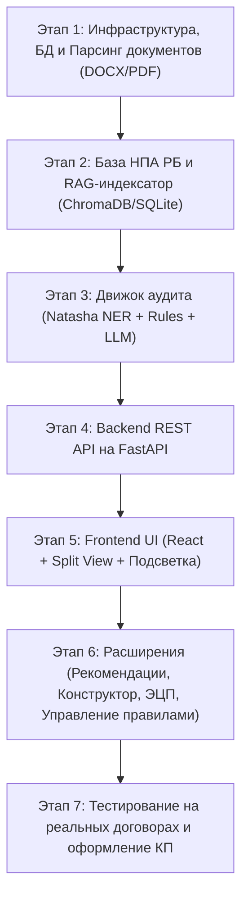

# Техническое задание (TASK.md)

## Курсовой проект: «Система автоматизированного аудита и проверки соответствия нормативно-правовым актам в электронном документообороте»

* **Кодовое название проекта:** `EDM-Auditor`
* **Учебное заведение:** БГУИР
* **Целевая юрисдикция:** Законодательство Республики Беларусь (Инструкция по делопроизводству, Трудовой кодекс РБ,
  Гражданский кодекс РБ)
* **Технологический стек:** Python (FastAPI) + SQLite + React (Vite / TypeScript / Tailwind CSS) + Гибридный NLP/RAG
  пайплайн

---

## 1. Введение и назначение системы

### 1.1. Назначение

Система `EDM-Auditor` предназначена для автоматизированного анализа входящих электронных документов (трудовых
контрактов, договоров возмездного оказания услуг, подряда, кадровых приказов и сопутствующих регламентов) с целью
выявления юридических ошибок, рисков, противоречий законодательству Республики Беларусь и внутренних корпоративных
регламентов.

### 1.2. Основные задачи

1. Прием и разбор документов форматов **DOCX** и **PDF** (с текстовым слоем).
2. Извлечение ключевых фактов, сущностей и существенных условий (ФИО, реквизиты, УНП, суммы, валюта, сроки выплат,
   испытательный срок, ответственность).
3. Гибридный семантический и логико-нормативный аудит по базе статей ТК РБ и ГК РБ с использованием векторного поиска
   (RAG) и языковой модели.
4. Предоставление интерактивного веб-интерфейса с визуализацией документа, цветовой подсветкой рисков/нарушений и
   прямыми ссылками на статьи законодательства РБ.
5. Формирование рекомендаций по устранению выявленных нарушений.
6. Модуль динамического управления нормативной базой и проверочными правилами.
7. Дополнительные модули масштабирования: конструктор типовых кадровых документов, эмуляция проверки ЭЦП, ролевая модель
   (RBAC).

---

## 2. Архитектура и стек технологий

### 2.1. Технологический стек

* **Backend:**
    * Язык: Python 3.11+
    * Фреймворк: **FastAPI** (высокопроизводительный асинхронный REST API, автогенерация OpenAPI/Swagger)
    * База данных: **SQLite** (быстрое развертывание, отсутствие внешних СУБД-зависимостей) через **SQLAlchemy 2.0 (
      asyncio)** или **aiosqlite**
    * Векторная база для RAG: **ChromaDB** / **SQLite-vec** / **FAISS** (локальное хранилище эмбеддингов статей НПА)
* **Frontend:**
    * Фреймворк: **React 18/19** (TypeScript, Vite)
    * Стилизация и UI: **Tailwind CSS**, компонентная библиотека (shadcn/ui или Lucide-React)
    * Визуализация текста/разметки: кастомный компонент документа с интерактивной подсветкой спанов (Highlight Spans)
* **NLP & Аналитический модуль:**
    * Парсинг документов: `python-docx`, `pypdf`, `pdfplumber`
    * Извлечение сущностей (NER / RegEx): библиотека **Natasha** (специализированная для русского языка: персоны,
      организации, даты, адреса), библиотека регулярных выражений для реквизитов РБ (УНП, счета IBAN, паспортные
      данные/идентификаторы)
    * Эмбеддинги для RAG: русскоязычные модели эмбеддингов (например,
      `sentence-transformers/paraphrase-multilingual-MiniLM-L12-v2` или `cointegrated/rubert-tiny2`)
    * LLM-провайдер: абстрактный интерфейс (`LLMProvider`) с поддержкой:
        * Локальной модели через **Ollama** (например, `qwen2.5`, `mistral`, `llama3`)
        * Облачного API (**Google Gemini API** или **OpenAI API**) через переменные окружения

---

## 3. Нормативная база и предметная область (Республика Беларусь)

Система комплектуется базой правил и оцифрованных статей НПА:

### 3.1. Трудовое право (ТК РБ)

* **Обязательные существенные условия трудового контракта (ст. 19, 261-2 ТК РБ):**
    * Срок действия контракта (от 1 года до 5 лет, ст. 261-3 ТК РБ).
    * Режим труда и отдыха, продолжительность отпуска (не менее 24 календарных дней, ст. 155 ТК РБ).
    * Условия оплаты труда (оклад, надбавки, дни выплаты заработной платы — не реже 1 раза в месяц для контрактов, ст.
      261-2 ТК РБ).
    * Испытательный срок (не более 3 месяцев, запрет для определенных категорий лиц, ст. 28 ТК РБ).
    * Материальная ответственность (ст. 400, 404 ТК РБ).
* **Приказы по личному составу:**
    * Приказы о приеме, переводе, увольнении (соответствие формулировок статьям ТК РБ, ст. 35, 42, 44 ТК РБ).

### 3.2. Гражданско-правовые договоры (ГК РБ)

* **Договор подряда / возмездного оказания услуг (главы 37, 39 ГК РБ):**
    * Проверка на подмену трудовых отношений гражданско-правовыми (отсутствие подчинения правилам внутреннего трудового
      распорядка, отсутствие регулярной ежемесячной зарплаты вместо оплаты результата).
    * Существенные условия: предмет договора, начальный и конечный сроки выполнения работ (ст. 662 ГК РБ), цена или
      порядок ее определения (ст. 663 ГК РБ).
    * Реквизиты: УНП (9 цифр для РБ), корректность банковских реквизитов формата IBAN (BY..), подписи сторон.

### 3.3. Инструкция по делопроизводству (Постановление Минюста РБ № 4, СТБ 6.38-2016)

* **Обязательные реквизиты и формуляр документов:**
    * Наличие базовых реквизитов бланка: наименование организации, вид документа, дата, регистрационный номер (индекс),
      место составления или издания.
    * Заголовок к тексту (грамматическое и смысловое согласование с наименованием вида документа, формулировка ответа на
      вопрос «о чем?» или «кого?»).
    * Оформление реквизита «Подпись» (наименование должности лица, включая наименование организации при необходимости,
      личная подпись, расшифровка подписи — инициалы перед фамилией).
    * Отметка об исполнителе (фамилия/инициалы исполнителя и контактный номер телефона в нижнем левом углу лицевой
      стороны последнего листа).
    * Отметка о наличии приложений (правильность указания количества листов и экземпляров при ссылке на приложения в
      тексте).
* **Требования к оформлению распорядительных документов (кадровых приказов):**
    * Разделение на констатирующую часть (основание, ссылка на нормативные акты или обстоятельства) и распорядительную
      часть («ПРИКАЗЫВАЮ:»).
    * Обязательное указание документального основания в конце пунктов приказа (заявление работника, трудовой контракт,
      докладная записка).
    * Наличие визы ознакомления работника с приказом под подпись с обязательным указанием даты ознакомления.
* **Электронные документы и реквизиты ЭД:**
    * Требования к оформлению электронных документов и их копий: реквизиты внешней и внутренней аутентичности, отметка
      об электронной цифровой подписи (ЭЦП), штамп времени.

---

## 4. Функциональные требования (FR)

### Модуль 1: Прием и предобработка документов (Ingestion)

* **FR-1.1:** Загрузка файлов `.docx` и `.pdf` через drag-and-drop в веб-интерфейсе.
* **FR-1.2:** Извлечение форматированного текста, разбивка на параграфы, разделы и нумерованные пункты с сохранением
  структуры смещений (offset/coordinates) для точной подсветки.
* **FR-1.3:** Определение типа документа (автоклассификация: Трудовой контракт, Договор подряда, Приказ об увольнении и
  т.д.).

### Модуль 2: Извлечение сущностей и фактов (Information Extraction)

* **FR-2.1:** Извлечение сторон договора (Наниматель / Работник, Заказчик / Исполнитель), реквизитов (УНП, паспортные
  данные, адрес, IBAN).
* **FR-2.2:** Извлечение временных параметров (дата заключения, срок действия договора, дата начала работы,
  испытательный срок, периодичность выплат).
* **FR-2.3:** Извлечение финансовых условий (сумма оклада/вознаграждения, надбавки, валюта — BYN/USD/EUR/RUB, порядок
  выплаты).
* **FR-2.4:** Извлечение обязательств и условий (отпуск, штрафные санкции, условия расторжения).

### Модуль 3: Движок аудита и нормативной верификации (Audit & Verification Engine)

* **FR-3.1 (Детерминированный аудит):** Проверка жестких формальных правил:
    * Проверка обязательных реквизитов (наличие УНП, подписей, даты).
    * Контроль срока контракта по ТК РБ (минимум 1 год, максимум 5 лет).
    * Контроль продолжительности отпуска (не менее 24 календарных дней).
    * Контроль срока испытания (не более 3 месяцев).
* **FR-3.2 (Семантический аудит через RAG + LLM):**
    * Поиск релевантных статей ТК/ГК РБ по тексту подозрительного пункта через векторный поиск.
    * Анализ на юридические коллизии (например, ухудшение положения работника по сравнению с законодательством, скрытые
      трудовые отношения в договоре подряда).
    * Классификация критичности нарушения: `Критическое (Блокирующее)`, `Предупреждение (Средний риск)`,
      `Информационное (Рекомендация)`.
* **FR-3.3:** Генерация структурированного JSON-отчета аудита со списком найденных несоответствий, привязкой к тексту
  документа и цитатами нарушенных статей НПА РБ.

### Модуль 4: Веб-интерфейс и визуализация аудита (UI/UX)

* **FR-4.1:** Двухоконный интерфейс аудита (Split View):
    * **Левое окно:** Текст проверяемого документа с цветными маркерами нарушений (красный / желтый / синий).
    * **Правое окно:** Интерактивный список замечаний с фильтрацией по уровню критичности.
* **FR-4.2:** Двусторонняя синхронизация: при клике на замечание в списке документ скроллится к соответствующему пункту;
  при клике на подсвеченный фрагмент в тексте раскрывается карточка нарушения.
* **FR-4.3:** Карточка замечания содержит:
    * Краткое описание проблемы.
    * Нарушенная норма (ссылка и цитата статьи ТК РБ / ГК РБ).
    * Рекомендация по исправлению формулировки (с кнопкой «Скопировать готовый фрагмент»).
* **FR-4.4:** Экспорт отчета об аудите в PDF / HTML или скачивание размеченного DOCX с комментариями.

### Модуль 5: Динамическое управление базой НПА и правил (Rule Manager)

* **FR-5.1:** Просмотр и редактирование статей нормативной базы (ТК РБ, ГК РБ).
* **FR-5.2:** Создание и редактирование пользовательских правил проверки (например, регламенты конкретной компании:
  «Аванс выплачивается строго 20 числа»).
* **FR-5.3:** Переиндексация векторной базы при обновлении статей.

### Модуль 6: Расширенный функционал (Конструктор, ЭЦП, Роли)

* **FR-6.1 (Конструктор кадровых документов):** Пошаговый генератор типовых документов (Трудовой контракт, Договор
  подряда, Приказ) с валидацией вводимых данных на лету по правилам ТК РБ.
* **FR-6.2 (ЭЦП):** Модуль валидации/эмуляции электронной подписи (проверка целостности файла, отображение статуса
  сертификата и штампа времени).
* **FR-6.3 (RBAC):** Разграничение ролей: `Администратор` (управление НПА/правилами), `Юрист / Аудитор` (полный аудит и
  резолюции), `Сотрудник / Кадровик` (загрузка и создание документов).

---

## 5. Структура базы данных (SQLite)

```sql
-- Пользователи и роли
CREATE TABLE users
(
    id              INTEGER PRIMARY KEY AUTOINCREMENT,
    username        TEXT UNIQUE NOT NULL,
    email           TEXT UNIQUE NOT NULL,
    hashed_password TEXT        NOT NULL,
    role            TEXT        NOT NULL DEFAULT 'auditor', -- admin, auditor, hr
    created_at      DATETIME             DEFAULT CURRENT_TIMESTAMP
);

-- Документы
CREATE TABLE documents
(
    id              INTEGER PRIMARY KEY AUTOINCREMENT,
    user_id         INTEGER,
    title           TEXT NOT NULL,
    file_type       TEXT NOT NULL,                    -- docx, pdf
    file_path       TEXT NOT NULL,
    raw_text        TEXT,
    classified_type TEXT,                             -- employment_contract, service_agreement, order, etc.
    status          TEXT NOT NULL DEFAULT 'uploaded', -- uploaded, processing, audited, error
    created_at      DATETIME      DEFAULT CURRENT_TIMESTAMP,
    FOREIGN KEY (user_id) REFERENCES users (id)
);

-- База Нормативно-Правовых Актов (НПА)
CREATE TABLE legal_acts
(
    id             INTEGER PRIMARY KEY AUTOINCREMENT,
    code_name      TEXT NOT NULL, -- TK_RB, GK_RB, INSTR_DELOPR
    act_title      TEXT NOT NULL,
    article_number TEXT NOT NULL,
    article_title  TEXT,
    content        TEXT NOT NULL,
    source_url     TEXT,
    created_at     DATETIME DEFAULT CURRENT_TIMESTAMP
);

-- Правила проверки (Rule Engine)
CREATE TABLE audit_rules
(
    id              INTEGER PRIMARY KEY AUTOINCREMENT,
    rule_code       TEXT UNIQUE NOT NULL,
    name            TEXT        NOT NULL,
    doc_type        TEXT        NOT NULL,
    severity        TEXT        NOT NULL, -- critical, warning, info
    description     TEXT        NOT NULL,
    legal_act_id    INTEGER,
    check_type      TEXT        NOT NULL, -- deterministic, semantic_rag
    parameters_json TEXT,
    is_active       BOOLEAN DEFAULT 1,
    FOREIGN KEY (legal_act_id) REFERENCES legal_acts (id)
);

-- Отчеты и результаты проверок
CREATE TABLE audit_reports
(
    id               INTEGER PRIMARY KEY AUTOINCREMENT,
    document_id      INTEGER NOT NULL,
    total_violations INTEGER  DEFAULT 0,
    critical_count   INTEGER  DEFAULT 0,
    warning_count    INTEGER  DEFAULT 0,
    summary_text     TEXT,
    created_at       DATETIME DEFAULT CURRENT_TIMESTAMP,
    FOREIGN KEY (document_id) REFERENCES documents (id)
);

-- Конкретные нарушения в документе
CREATE TABLE audit_findings
(
    id              INTEGER PRIMARY KEY AUTOINCREMENT,
    report_id       INTEGER NOT NULL,
    rule_id         INTEGER,
    severity        TEXT    NOT NULL,
    title           TEXT    NOT NULL,
    description     TEXT    NOT NULL,
    start_char      INTEGER,
    end_char        INTEGER,
    excerpt         TEXT,
    law_article_ref TEXT,
    recommendation  TEXT,
    FOREIGN KEY (report_id) REFERENCES audit_reports (id),
    FOREIGN KEY (rule_id) REFERENCES audit_rules (id)
);
```

---

## 6. План и этапы разработки



### Этап 1: Каркас проекта, Ingestion и парсинг

- [x] Инициализация репозитория и окружения Python (`pyproject.toml` / `requirements.txt`).
- [x] Сервис парсинга документов: модуль извлечения текста и структуры из `.docx` и `.pdf`.
- [x] Разбивка документов на абзацы с индексацией позиций.
- [x] Слой хранения документов, абзацев, НПА, правил и аудиторских отчётов
  на SQLite с миграциями Alembic.

### Этап 2: База НПА РБ и RAG пайплайн

- [ ] Подготовка стартового датасета статей ТК РБ (ст. 19, 28, 155, 261-2 и др.) и ГК РБ.
- [x] Настройка локального векторного хранилища и контракта генерации эмбеддингов
  для семантического поиска; подключение production-модели выполняется отдельно.

### Этап 3: Аналитический модуль и движок верификации

- [ ] Экстрактор сущностей через Natasha + RegEx (реквизиты сторон, даты, деньги, сроки).
- [ ] Реализация детерминированных валидаторов (проверка граничных условий ТК РБ).
- [ ] Реализация RAG-валидатора с вызовом LLM для семантического поиска коллизий.
- [ ] Генератор рекомендаций по исправлению формулировок.

### Этап 4: FastAPI Backend

- [ ] REST API endpoints:
    - `POST /api/documents/upload` — загрузка документа.
    - `POST /api/documents/{id}/audit` — запуск аудита.
    - `GET /api/documents/{id}/report` — получение структурированного отчета.
    - `GET /api/rules`, `POST /api/rules` — управление правилами.
    - `GET /api/legal-acts` — просмотр статей НПА.

### Этап 5: React Frontend

- [ ] Инициализация React SPA (Vite + TS + Tailwind CSS).
- [ ] Главная страница загрузки документов (Drag-and-Drop, индикаторы прогресса).
- [ ] Экран аудита (Split View: интерактивный документ со спанами нарушений + панель рекомендаций).
- [ ] Страница управления базой НПА и правилами.

### Этап 6: Дополнительные модули

- [ ] Конструктор типовых документов (Трудовой контракт, Приказ) по регламентированным формам РБ.
- [ ] Интеграция эмуляции ЭЦП.
- [ ] Экспорт итогового отчета в PDF.

### Этап 7: Валидация и защита курсового проекта

- [ ] Набор тестовых договоров с преднамеренными ошибками (заниженный отпуск, превышенный испытательный срок, скрытые
  трудовые отношения в договоре подряда).
- [ ] Подготовка документации, скриншотов и пояснительной записки.

---

## 7. Критерии приемки (Definition of Done)

1. **Загрузка и парсинг:** Документы форматов DOCX и PDF корректно разбираются на текстовые блоки с сохранением
   нумерации пунктов.
2. **Точность детекции ошибок:** На тестовом датасете система безошибочно определяет:
    * Нарушения сроков контракта (< 1 года или > 5 лет по ТК РБ).
    * Отпуск менее 24 календарных дней (ст. 155 ТК РБ).
    * Испытательный срок свыше 3 месяцев (ст. 28 ТК РБ).
    * Отсутствие существенных реквизитов (УНП, сроки выплат, подписи).
    * Признаки трудовых отношений в договоре подряда.
3. **Интерактивный UI:** При клике на ошибку в отчете происходит плавная прокрутка и подсветка проблемного пункта в
   тексте документа, отображается номер нарушенной статьи ТК/ГК РБ и готовая рекомендация по исправлению.
4. **Автономность:** Проект легко разворачивается локально с базой SQLite без необходимости сложной настройки внешних
   баз данных.
